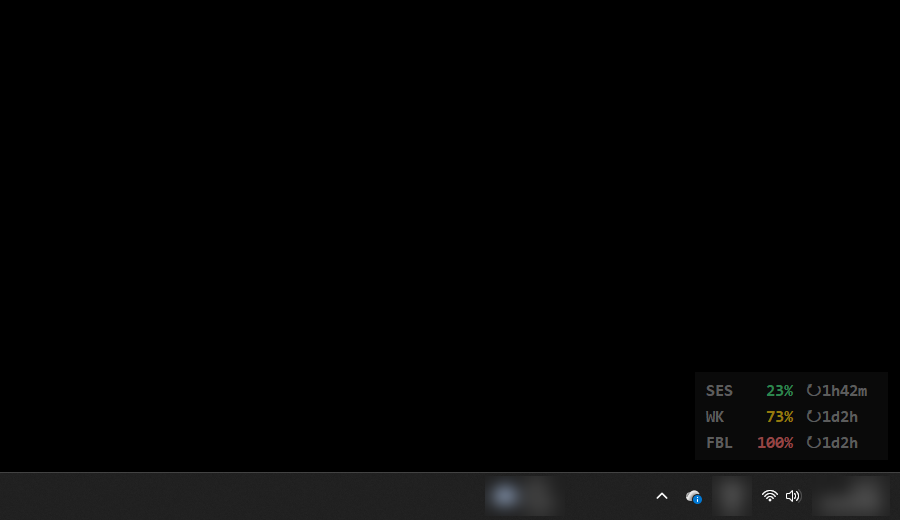
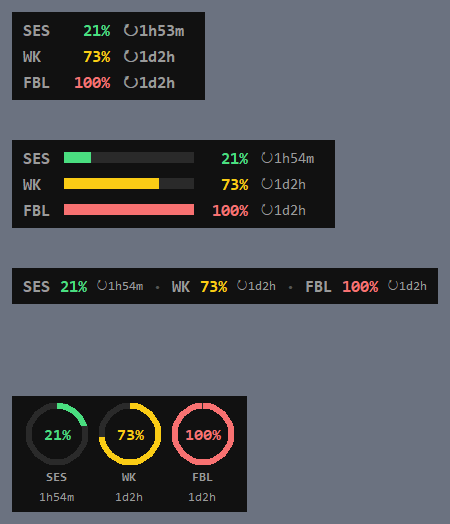
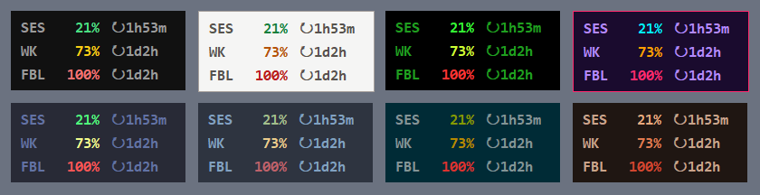

# Claude Usage Overlay

A tiny always-on-top usage meter for Claude, like an FPS counter in a game. It sits in a corner of your screen and shows how much of your Claude plan limits you've used, live:

- **SES**: current 5-hour session
- **WK**: this week (all models)
- **Per-model weekly limits** (e.g. **FBL** for Fable) if your plan has them

Each value has a countdown (`↻`) to its reset. Colors go green → yellow → red as you approach a limit.





## Requirements

- **Claude Code**, logged in with a Claude subscription (Pro / Max). The overlay reuses Claude Code's login, so there's no separate sign-in.
- **Python 3.9+** with tkinter (the standard python.org / Microsoft Store installer on Windows includes it). No other packages are needed.
- Built and tested on **Windows 10/11**. macOS and Linux should work but haven't been tested much (see [Notes](#notes)).

## Install

1. Download this repo (green **Code** button → *Download ZIP*) and unzip it somewhere permanent, or `git clone` it.
2. Double-click `usage_overlay.pyw` (or run `pythonw usage_overlay.pyw`).
3. Right-click the overlay → **Start with Windows** so it launches when you log in.

### Recommended: live updates from Claude Code's status line

Claude Code passes your session and weekly usage to its status line on every reply. If you forward that to the overlay, those two numbers update instantly and never hit the API's rate limit. The API is then only checked every 10 minutes, for per-model limits such as Fable.

- **No status line yet:** add this to `~/.claude/settings.json` (use the real path):
  ```json
  "statusLine": { "type": "command", "command": "python C:/path/to/claude_usage_feed.py" }
  ```
- **Already have a Python status line script:** copy the `write_usage_feed()` function from [`claude_usage_feed.py`](claude_usage_feed.py) into it and call `write_usage_feed(data)` with the parsed JSON.

The feed is saved to `~/.claude/usage-overlay-feed.json` and contains only usage percentages and reset times.

## Using it

| Action | What it does |
|---|---|
| **Right-click** | Opens the menu |
| **Drag** | Moves the overlay (where you leave it is remembered) |
| **Double-click** | Refreshes now |

Menu options:

- **Theme**: Midnight, Paper, Terminal, Synthwave, Dracula, Nord, Solarized, Ember
- **Skin**: Classic (text rows), Bars, Compact (one line), Rings
- **Size**: Small / Medium / Large / Huge
- **Opacity**: 30-100%
- **Show**: `% used` or `% left`
- **Show reset timers**: on / off
- **Position**: snap to any corner (above the taskbar)
- **Lock position**: prevents accidental dragging
- **Start with Windows**: on / off
- **Refresh now** / **Exit**



Your settings are saved to `overlay_config.json` next to the script.

## How it works

Every 3 minutes (every 10 with the status-line feed) the overlay reads the OAuth token that Claude Code stores in `~/.claude/.credentials.json` and calls the same usage endpoint that Claude Code's `/usage` command uses. The token is sent only to `api.anthropic.com` and is never written anywhere else.

If the numbers turn grey with a `!` line underneath, the last refresh failed:

- **token expired - open Claude Code**: the token expires after a while and only Claude Code renews it. Start Claude Code once and the overlay recovers by itself.
- **offline**: there's no connection. It retries every 3 minutes.
- **rate limited**: the usage endpoint is asking for fewer requests. Claude Code itself uses it too, so this can happen even when the overlay polls slowly. The status-line feed above avoids it for session and week. The overlay waits 5 minutes, then 10, 20 and up to 30 minutes if it keeps happening, and shows a countdown to the next try. Avoid running several copies at once, since they add up.

## Notes

- **Unofficial.** This isn't affiliated with or endorsed by Anthropic. It uses an undocumented endpoint that may change or break without notice.
- **macOS**: Claude Code keeps credentials in the Keychain. The overlay tries `security find-generic-password -s "Claude Code-credentials"`, and macOS may ask you to allow access. Right-click may be Ctrl-click on a trackpad.
- **Linux**: transparency needs a compositing window manager.
- **Fullscreen games**: some exclusive-fullscreen games draw over every window. Use borderless/windowed fullscreen if you want the overlay to stay visible.

## Uninstall

Right-click → untick **Start with Windows**, then **Exit**, and delete the folder.

## License

[MIT](LICENSE)
